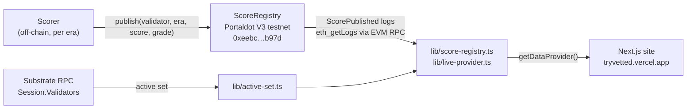

# Vetted

Validator risk report cards for the Portaldot network. Built for Portaldot Hacker House / DoraHacks, Node Ops & Tooling.

Each era, Vetted scores a validator from 0 to 100 and publishes that score on-chain. This app is the nominator-facing dashboard: a leaderboard, a per-validator report card, and a flow for building a safer nomination set.

- **Live site:** https://tryvetted.vercel.app
- **Demo video:** https://youtu.be/PwV31kM66DI

## Live on Portaldot V3 testnet

Scores are read live from the `ScoreRegistry` contract on PortaldotV3 Test (chain id 420420777). The site pulls every `ScorePublished` log over the EVM RPC (`eth_getLogs`, cached for a minute) and shows the latest score per validator. Two validators are scored right now, the two in the testnet's active set.

| | |
| --- | --- |
| Contract | `0xeebc363c7af7ed8e888da07e959043517ae4b97d` |
| Deployed at block | 107303 |
| Source | [`contracts/ScoreRegistry.sol`](contracts/ScoreRegistry.sol) |
| EVM RPC | `https://test-evm-rpc-v3.portaldot.dev` |
| Substrate RPC | `wss://test-node-v3.portaldot.dev` |
| Explorer | `https://node-console.portaldot.dev` |

That file is the source for the live deployment above. `publish` emits `ScorePublished(bytes32 indexed validator, uint256 indexed era, uint256 score, uint256 grade)`, the log `lib/score-registry.ts` decodes. From `contracts/`, `npm install` then `npm test` compiles it and checks the grade bands. This repo does not redeploy the contract.

Publish transactions (`ScorePublished` logs on the contract):

| Block | Tx | Validator | Era | Score |
| --- | --- | --- | --- | --- |
| 144339 | `0x76a7bd7259f660c546c1532a46ba79d353e1df5121d11fbcc8838f836c969dcf` | `0x849a279f…` | 39 | 100 / A |
| 144343 | `0xf197cb76814284676fb41ee3cad7e07452a309adab6f1a1616608d41de6e874d` | `0xd40a5b57…` | 39 | 100 / A |

An earlier test publish for Alice's dev account (era 1285, block 107808, tx `0xcf69a7c7600b6c896460da472f4f2049d732a3fecbd344c074737b12ac9b1894`) is still on the contract. Alice is not a validator on this chain, so the site hides her (`lib/active-set.ts`).

Not live yet: staking fields from the Substrate side (commission, slashes, chills, stake, era points) are not read, so they show as zero or empty. The wallet step in `/nominate` is still mocked and does not submit `staking.nominate`.

## Portaldot ecosystem

### Why Portaldot

1. Portaldot V3 runs validators and EVM contracts on one stack. Vetted's scores can live on-chain next to the nodes they rate, not on a separate L2.
2. Stakers and node ops need a trust signal that is not a Discord spreadsheet. [`ScoreRegistry`](contracts/ScoreRegistry.sol) at `0xeebc363c7af7ed8e888da07e959043517ae4b97d` makes risk readable by any wallet or dashboard.
3. The same pattern scales. Once scores are on V3, staking UIs and explorer badges can pull them without trusting our server.

Who consumes the score: stakers picking validators · node ops benchmarking peers · wallets/dashboards showing a risk badge.

Next integrations (named only, not built): wallet badge · staking UI.

## Architecture



The scorer is not part of this repo; it writes scores with `publish`. The site only reads: `lib/score-registry.ts` decodes the logs, `lib/active-set.ts` reads the current session validators to filter out non-validators, and `lib/live-provider.ts` maps the latest score per validator into the screens.

## Screens

| Route | What it shows |
| --- | --- |
| `/` | Leaderboard. Stat cards, grade, 0–100 score, era-point sparkline, slashes, commission, and a source badge (Mainnet history or Testnet; scores read from the testnet contract show Testnet). Search, filter, and sort. Cards replace the table on narrow screens. |
| `/validator/[id]` | Report card. Scored validators get a point-by-point breakdown, history, and a rewards chart. Validators with fewer than 28 eras get the "Not enough history" state and are never graded F for being new. The same source badge sits next to the name. |
| `/nominate` | Card grid plus a sticky "Your set" panel. The nomination cap stays 16. The staking pallet does not publish MaxNominations, so `NOMINATION_CAP` in `lib/config.ts` stays that placeholder. Review and the wallet step are mocked. |
| `/methodology` | How the score is explained. |
| `/contract` | Chain constants and the plan for swapping in live reads. |

## Stack

Next.js (App Router), TypeScript, Tailwind CSS. It deploys on the Vercel free tier: Node.js runtime, no Edge runtime, no paid platform features. Below the `xl` breakpoint the leaderboard switches from the table to cards so a phone does not scroll sideways.

## Setup

```bash
npm install
cp .env.example .env.local   # official endpoints; set NEXT_PUBLIC_DATA_SOURCE=mock for sample data
npm run dev
```

Open [http://localhost:3000](http://localhost:3000).

In `npm run dev`, `?state=` previews loading, empty, and error screens. A production build ignores the query.

| URL | State |
| --- | --- |
| `/` | Data as of the current era, on the overview |
| `/?state=loading` | Leaderboard row skeletons |
| `/?state=empty` | No validators returned, with Retry |
| `/?state=error` | Scores could not be loaded, with Retry |
| `/validator/lagos-validator?state=loading` | Report skeletons: score, sparkline, factors, history, rewards |
| `/validator/lagos-validator?state=error` | This report could not be loaded |
| `/validator/not-a-validator` | No validator with that id |
| `/validator/harmattan-node` | Not enough history, eras recorded versus 28 |
| `/nominate?state=loading` | Nomination skeletons |
| `/nominate?state=empty` | No validators returned |
| `/nominate?state=error` | The nomination list could not be loaded |
| `/nominate?state=history` | A NEW validator is in the set and left out of the set score |

| Script | |
| --- | --- |
| `npm run dev` | Local dev server |
| `npm run build` | Production build |
| `npm run start` | Serve the production build |
| `npm run lint` | ESLint |

Fonts are loaded with `next/font`: Space Grotesk for headings, Inter for body text, JetBrains Mono for numbers and addresses. The accent is teal `#2DD4BF`. Grade colors are A green, B lime, C yellow, D orange, F red, and NEW slate.

## Data layer

Pages do not import data directly. They call `getDataProvider()` from `lib/data.ts`, which returns the live provider by default. Set `NEXT_PUBLIC_DATA_SOURCE=mock` to use the sample validators for design work; only then does the "Testnet not connected, showing sample data" banner appear.

| File | Role |
| --- | --- |
| `lib/types.ts` | `Validator`, `NetworkOverview`, and `ValidatorDataProvider`. |
| `lib/config.ts` | Env-driven chain id, RPCs, token, contract address and deploy block, with confirmed testnet defaults. |
| `lib/score-registry.ts` | Reads and decodes `ScorePublished` logs from the contract. |
| `lib/active-set.ts` | Reads `Session.Validators` over the Substrate RPC. |
| `lib/live-provider.ts` | Default provider: latest on-chain score per active validator. |
| `lib/mock-provider.ts` | Sample validators, used only with `NEXT_PUBLIC_DATA_SOURCE=mock`. |
| `lib/chain-events.ts` | Pallet event names and field order for a future indexer. |
| `lib/scoring.ts` | Grade bands, stake-weighted set score, nomination warnings. |
| `lib/format.ts` | Address shortening, era and token formatting, explorer links. |

## Chain notes

- Amounts use **tPOT** with **14 decimals** unless `NEXT_PUBLIC_TOKEN_SYMBOL` / `NEXT_PUBLIC_TOKEN_DECIMALS` are set.
- SS58 prefix **42** is the display id. H160 values are 20-byte Portaldot account ids, **not Ethereum addresses**.
- Blocks are 6s, sessions are 600 blocks, an era is 6 sessions (about 6 hours). `NOMINATION_CAP` stays 16 because the staking pallet does not publish MaxNominations.

## Not done yet

Reading staking fields from the Substrate RPC, a connected wallet, and a real `staking.nominate` extrinsic (the success tx in `/nominate` is `MOCK_NOMINATION_TX`).
