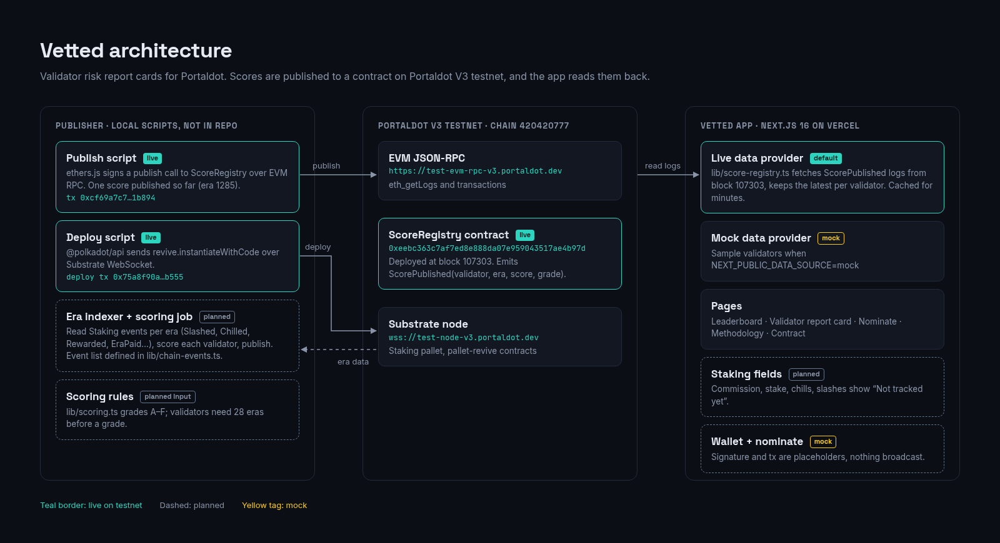

# Vetted

Validator risk report cards for the Portaldot network. Built for Portaldot Hacker House / DoraHacks, Node Ops & Tooling.

Each era, Vetted scores a validator from 0 to 100 and publishes that score on-chain. This app is the nominator-facing dashboard: a leaderboard, a per-validator report card, and a flow for building a safer nomination set. **The screens still use sample data.** Portaldot has published the V3 testnet: chain name PortaldotV3 Test, chain id 420420777, Substrate `wss://test-node-v3.portaldot.dev`, EVM `https://test-evm-rpc-v3.portaldot.dev`, explorer `https://node-console.portaldot.dev`. Scores will come from mainnet history and be published on the testnet contract. The testnet's two live validators are shown alongside those scores. Until `getDataProvider()` reads the chain, every number on screen comes from the mock provider.

## Architecture



## Screens

| Route | What it shows |
| --- | --- |
| `/` | Leaderboard. Stat cards, grade, 0–100 score, era-point sparkline, slashes, commission, and a source badge (Mainnet history or Testnet; scores read from the testnet contract show Testnet). Search, filter, and sort. Cards replace the table on narrow screens. |
| `/validator/[id]` | Report card. Scored validators get a point-by-point breakdown, history, and a rewards chart. Validators with fewer than 28 eras get the "Not enough history" state and are never graded F for being new. The same source badge sits next to the name. |
| `/nominate` | Card grid plus a sticky "Your set" panel. The nomination cap stays 16. The staking pallet does not publish MaxNominations, so `NOMINATION_CAP` in `lib/config.ts` stays that placeholder. Review and the wallet step are mocked. |
| `/methodology` | How the score is explained. |
| `/contract` | Chain constants and the plan for swapping in live reads. |

## Stack

Next.js (App Router), TypeScript, Tailwind CSS. It deploys on the Vercel free tier: Node.js runtime, no Edge runtime, no paid platform features. `npm run build` prerenders the mock pages. Below the `xl` breakpoint the leaderboard switches from the table to cards so a phone does not scroll sideways.

## Setup

```bash
npm install
cp .env.example .env.local   # official endpoints; leave an RPC empty to keep the banner
npm run dev
```

Open [http://localhost:3000](http://localhost:3000).

In `npm run dev`, `?state=` previews the screens the live provider will need. A production build ignores the query.

| URL | State |
| --- | --- |
| `/` | Data as of the current era, on the overview |
| `/?state=loading` | Leaderboard row skeletons |
| `/?state=empty` | No validators returned, with Retry |
| `/?state=error` | Scores could not be loaded, with Retry |
| `/validator/lagos-validator?state=loading` | Report skeletons: score, sparkline, factors, history, rewards |
| `/validator/lagos-validator?state=error` | This report could not be loaded |
| `/validator/not-a-validator` | No validator with that id |
| `/validator/harmattan-node` | Not enough history, eras recorded versus 28 |
| `/nominate?state=loading` | Nomination skeletons |
| `/nominate?state=empty` | No validators returned |
| `/nominate?state=error` | The nomination list could not be loaded |
| `/nominate?state=history` | A NEW validator is in the set and left out of the set score |

| Script | |
| --- | --- |
| `npm run dev` | Local dev server |
| `npm run build` | Production build |
| `npm run start` | Serve the production build |
| `npm run lint` | ESLint |

Fonts are loaded with `next/font`: Space Grotesk for headings, Inter for body text, JetBrains Mono for numbers and addresses. The accent is teal `#2DD4BF`. Grade colors are A green, B lime, C yellow, D orange, F red, and NEW slate.

## Data layer

Pages do not import mock rows. They call `getDataProvider()` from `lib/data.ts`.

| File | Role |
| --- | --- |
| `lib/types.ts` | `Validator`, `NetworkOverview`, and `ValidatorDataProvider`. |
| `lib/config.ts` | Env-driven chain id, RPCs, and token settings. SS58 prefix, era timing, and the nomination-cap placeholder. |
| `lib/chain-events.ts` | Pallet event names and field order for a future indexer. |
| `lib/mock-provider.ts` | The nine sample validators and the network stats from the mockup. |
| `lib/scoring.ts` | Grade bands, stake-weighted set score, nomination warnings. |
| `lib/format.ts` | Address shortening, era and token formatting, explorer links. |
| `lib/data.ts` | Returns the provider. This is the file to edit when going live. |

The mock overview (142 scored, 38 graded A, 6 slashed, 5.0% median commission) is the network snapshot from the design. The table is a nine-validator sample, including Harmattan Node as NEW.

## Swapping in the chain

Leave the React screens alone. Implement `ValidatorDataProvider` and return it from `getDataProvider()`.

1. **Substrate RPC** (`NEXT_PUBLIC_SUBSTRATE_RPC_URL`). Read staking and session state: commission, self-stake, era points, chill events, and slashes. Map them into the existing `Validator` fields.
2. **EVM RPC** (`NEXT_PUBLIC_EVM_RPC_URL`) **and the score contract.** Read the published grade, the 0–100 score, the era, and the transaction that wrote it. The on-chain score replaces the mock `factors` total. Keep the breakdown as a view over the same events the contract used.
3. **Amounts.** Set `NEXT_PUBLIC_TOKEN_SYMBOL` and `NEXT_PUBLIC_TOKEN_DECIMALS`. When they are unset the app falls back to the confirmed **tPOT** and **14 decimals**. Convert chain balances at the edge of the provider so components keep receiving whole-token numbers (or switch them to bigint strings in one place, `selfStake`).
4. **Addresses.** SS58 prefix **42** is the display id on the card. H160 values are 20-byte Portaldot account ids. **They are not Ethereum addresses.** Do not EIP-55 checksum them and do not treat them as mainnet accounts. The current session validator list is 32-byte ids; map those when the live provider lands.
5. **Chain id and RPCs.** `NEXT_PUBLIC_CHAIN_ID` defaults to the confirmed **420420777**. Substrate WSS is `wss://test-node-v3.portaldot.dev` and the EVM RPC is `https://test-evm-rpc-v3.portaldot.dev`. `NOMINATION_CAP` stays **16** in `lib/config.ts` because the staking pallet does not publish MaxNominations. Blocks are 6s, sessions are 600 blocks, and an era is 6 sessions (about 6 hours). History depth is 84 eras. `MIN_ERAS_TO_SCORE` (28) is still a product placeholder. `CURRENT_ERA` should come from staking `ActiveEra`.
6. **Explorer links.** `NEXT_PUBLIC_EXPLORER_URL` is `https://node-console.portaldot.dev` (no trailing slash). "View score on-chain" and "View on Portaldot explorer" append `/tx/<hash>`. Until that variable is set, both links stay inside the app on `/contract`.
7. **Indexer events.** Decode the pallet events in `lib/chain-events.ts` (Staking slashes, chills, kicks, rewards, era payouts, and preference changes; `Session.ValidatorDisabled`; `Offences.Offence`).
8. **Signing.** "Sign in your wallet" does not submit an extrinsic. Wire a wallet, then call the staking nominate extrinsic with the selected set and the bond amount. The mock success tx is `MOCK_NOMINATION_TX` in `lib/config.ts`.

Copy `.env.example` to `.env.local` to point at the official endpoints. With both RPC URLs empty, every page shows the banner "Testnet not connected — showing sample data". Set either URL and the banner goes away. The tables still use the mock provider until the client is implemented. Two sample rows are tagged Testnet (Ibadan Infra and Harmattan Node). The rest are Mainnet history.

## Not in this scaffold

Live scores, a connected wallet, and a real `staking.nominate` extrinsic. Filters, search, sort, the set builder, the source badges, and the three nominate steps all run on the mock provider.
